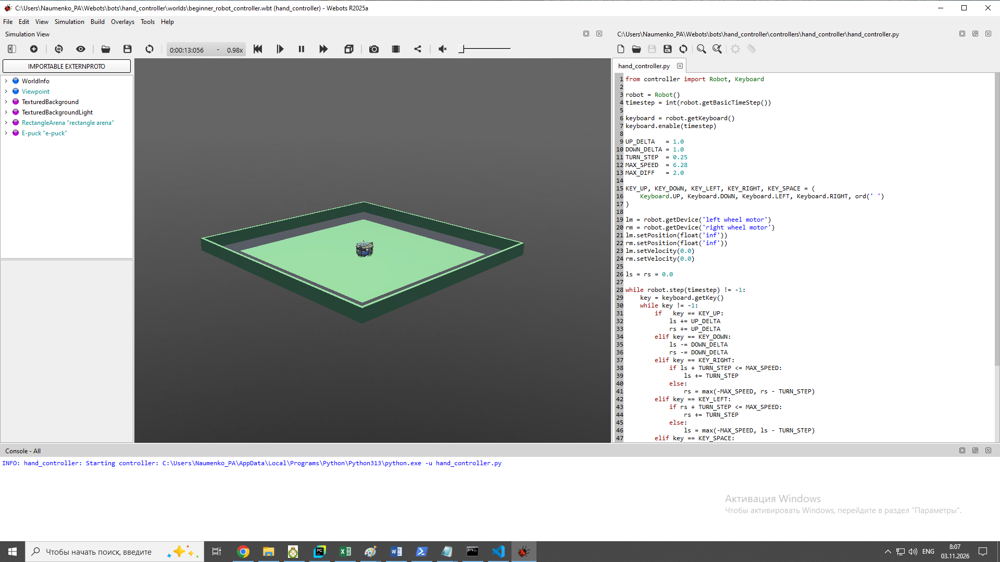

# Контроллер `hand_controller` — ручное управление e-puck с клавиатуры



Контроллер `hand_controller.py` позволяет управлять роботом **e-puck** в Webots прямо с клавиатуры: движение вперёд/назад, повороты и экстренная остановка.

Робот едет плавно: скорость не меняется скачком, а **накапливается по нажатиям**. При этом есть двойная защита — ограничение максимальной скорости колёс и ограничение разницы скоростей между ними.

Это отличный первый контроллер: он показывает, как читать клавиатуру, управлять моторами в velocity-режиме и ограничивать команды, чтобы робот не «дёргался».

---

## Содержание

- [Что умеет](#что-умеет)
- [Структура файлов](#структура-файлов)
- [Разбор кода](#разбор-кода)
- [Почему такой дизайн](#почему-такой-дизайн)
- [Частые проблемы](#частые-проблемы)
- [Что можно улучшить](#что-можно-улучшить)
- [Запуск](#запуск)

---

## Что умеет

| Клавиша | Действие |
|:---:|---|
| `↑` | Плавно ускоряться вперёд |
| `↓` | Плавно ускоряться назад |
| `→` | Поворот направо |
| `←` | Поворот налево |
| `Пробел` | Мгновенная остановка |

Одиночное нажатие слегка меняет скорость, удержание — накапливает эффект. Максимальная скорость колёс ограничена (`MAX_SPEED`), а разница скоростей между колёсами — отдельно (`MAX_DIFF`), чтобы развороты не были слишком резкими.

> ⚠️ **Важно:** клавиатура работает только тогда, когда окно 3D-вида Webots находится в фокусе.

---

## Структура файлов

Webots требует, чтобы имя папки контроллера совпадало с именем файла внутри неё:

```text
controllers/
└── hand_controller/
    └── hand_controller.py
```

---

## Разбор кода

### 1. Инициализация

```python
from controller import Robot, Keyboard

robot = Robot()
timestep = int(robot.getBasicTimeStep())

keyboard = robot.getKeyboard()
keyboard.enable(timestep)
```

- `Robot()` — точка входа в контроллер Webots.
- `getBasicTimeStep()` — базовый шаг симуляции (обычно **32 мс** для e-puck). Приводим к `int`, потому что `robot.step()` принимает целое.
- `getKeyboard()` + `enable(timestep)` — подписываемся на клавиатуру. Пока клавиатура не включена, `getKey()` будет возвращать `-1`.

### 2. Константы

```python
UP_DELTA   = 1.0    # шаг разгона вперёд, рад/с
DOWN_DELTA = 1.0    # шаг разгона назад, рад/с
TURN_STEP  = 0.25   # шаг поворота, рад/с
MAX_SPEED  = 6.28   # предел скорости колеса (~2π), рад/с
MAX_DIFF   = 2.0    # предел разницы скоростей колёс, рад/с
```

| Константа | Смысл |
|---|---|
| `UP_DELTA` / `DOWN_DELTA` | Насколько меняется скорость колёс за одно нажатие `↑` / `↓`. 1.0 рад/с — ощутимый шаг, но не рывок. |
| `TURN_STEP` | Шаг дифференциального поворота. Меньше, чем `UP_DELTA`, потому что повороты должны быть точнее. |
| `MAX_SPEED` | ≈ 2π — типичный максимум для моторов e-puck. Превышение приводит к клиппингу внутри Webots, но лучше ограничивать явно. |
| `MAX_DIFF` | Максимальная разница `ls - rs`. Ограничивает «крутость» поворота и не даёт роботу разворачиваться на месте слишком резко. |

### 3. Коды клавиш

```python
KEY_UP, KEY_DOWN, KEY_LEFT, KEY_RIGHT, KEY_SPACE = (
    Keyboard.UP, Keyboard.DOWN, Keyboard.LEFT, Keyboard.RIGHT, ord(' ')
)
```

`Keyboard.UP/DOWN/LEFT/RIGHT` — константы Webots для стрелок. Пробел передаётся через `ord(' ')`, потому что отдельной константы для него в API нет.

### 4. Моторы в velocity-режиме

```python
lm = robot.getDevice('left wheel motor')
rm = robot.getDevice('right wheel motor')

lm.setPosition(float('inf'))   # inf → режим скорости
rm.setPosition(float('inf'))

lm.setVelocity(0.0)            # стартуем неподвижно
rm.setVelocity(0.0)
```

**Ключевой момент:** `setPosition(float('inf'))` переводит мотор в режим скорости. В обычном режиме Webots крутит мотор к заданной позиции; с бесконечной позицией мотор просто крутится с заданной скоростью и не останавливается сам.

### 5. Переменные скорости

```python
ls = rs = 0.0   # left speed / right speed
```

Знак задаёт направление: **плюс — вперёд, минус — назад**.

### 6. Главный цикл и чтение клавиш

```python
while robot.step(timestep) != -1:
    key = keyboard.getKey()
    while key != -1:
        # ... обработка нажатия ...
        key = keyboard.getKey()
```

- `robot.step(timestep)` продвигает симуляцию; `-1` означает, что Webots закрыли — выходим.
- Внутренний `while key != -1` **вычитывает всю очередь** нажатий за шаг. Webots может вернуть несколько клавиш подряд, если они накопились между шагами — так мы не теряем ни одно нажатие.

### 7. Обработка клавиш

**Прямо и назад** — обе скорости меняются одинаково:

```python
if key == KEY_UP:
    ls += UP_DELTA
    rs += UP_DELTA

elif key == KEY_DOWN:
    ls -= DOWN_DELTA
    rs -= DOWN_DELTA
```

**Поворот направо** — хитрее. Сначала пытаемся увеличить скорость левого колеса (робот заворачивает вправо за счёт того, что левое быстрее правого). Если левое уже на максимуме — начинаем уменьшать правое, вплоть до отрицательных значений:

```python
elif key == KEY_RIGHT:
    if ls + TURN_STEP <= MAX_SPEED:
        ls += TURN_STEP
    else:
        rs = max(-MAX_SPEED, rs - TURN_STEP)
```

**Поворот налево** — симметрично:

```python
elif key == KEY_LEFT:
    if rs + TURN_STEP <= MAX_SPEED:
        rs += TURN_STEP
    else:
        ls = max(-MAX_SPEED, ls - TURN_STEP)
```

**Стоп** — полный сброс накопленных скоростей:

```python
elif key == KEY_SPACE:
    ls = rs = 0.0
```

### 8. Ограничение скоростей (клиппинг)

```python
ls = max(-MAX_SPEED, min(MAX_SPEED, ls))
rs = max(-MAX_SPEED, min(MAX_SPEED, rs))
```

Классический клиппинг в диапазон `[-MAX_SPEED, MAX_SPEED]`. Без него многократное нажатие `↑` разогнало бы робота до абсурдных значений.

### 9. Ограничение разницы скоростей

```python
d = ls - rs
if d > MAX_DIFF:
    ls = rs + MAX_DIFF
elif d < -MAX_DIFF:
    ls = rs - MAX_DIFF
```

`MAX_DIFF` защищает от двух вещей:

1. **Резких разворотов** — робот не «встаёт боком» за один шаг.
2. **Курьёзных ситуаций**, когда накопленные нажатия дают «закрученные» скорости и робот ведёт себя непредсказуемо.

> 📌 При ограничении приоритет у **правого** колеса (`ls` подтягивается к `rs`). Симметричный вариант — ограничивать обе скорости относительно среднего — тоже корректен, но этот проще для понимания.

### 10. Отправка команд моторам

```python
lm.setVelocity(ls)
rm.setVelocity(rs)
```

Моторы в velocity-режиме, поэтому `setVelocity()` сразу задаёт целевую скорость вращения.

---

## Почему такой дизайн

- **Накопительные нажатия, а не прямое управление.** Одно нажатие — маленький шаг, удержание — разгон. Это ближе к тому, как работает реальная телеметрия и пульты управления.
- **Раздельные ограничения скорости и разницы.** Скорость — общая «пропускная способность» моторов, разница — «резкость руля». Это две независимые характеристики, и смешивать их в один лимит было бы хуже.
- **Плавные повороты.** `TURN_STEP < UP_DELTA` — осознанный выбор: прямолинейное движение хочется набирать быстро, а рулить — точно.
- **Пробел вместо «просто отпустить клавиши».** В Webots отпускание клавиши не меняет скорость — робот поедет дальше. Явная кнопка-стоп даёт предсказуемое поведение.

---

## Частые проблемы

| Симптом | Причина / решение |
|---|---|
| Клавиши не реагируют | Окно 3D-вида не в фокусе — кликните по нему |
| `getKey()` всегда `-1` | Забыли `keyboard.enable(timestep)` |
| Робот стоит на месте | Не вызван `setPosition(float('inf'))` — мотор в позиционном режиме |
| `Controller not found` | Имя папки ≠ имя файла, либо в поле `controller` указано другое имя |
| Робот дёргается на поворотах | Уменьшите `TURN_STEP` и `MAX_DIFF` |

---

## Что можно улучшить

- Заменить «мгновенную» установку скорости на плавное изменение (**ramp**), чтобы избежать рывков.
- Добавить обратную связь по датчикам расстояния: если впереди препятствие — автоматически тормозить.
- Ввести отдельный режим точного позиционирования через `setPosition()` с энкодерами колёс.
- Поддерживать **WASD** как альтернативу стрелкам.
- Выводить текущие `ls` / `rs` в консоль или на OLED-дисплей робота для наглядности.
- Вынести константы в аргументы командной строки или `.env`, чтобы настраивать чувствительность без правки кода.

---

## Запуск

1. Откройте файл мира \hand_controller\worlds\beginner_robot_controller.wbt в **Webots**.
2. Запустите симуляцию (`Ctrl+2` / кнопка **Play**).
3. Кликните по окну 3D-вида, чтобы оно получило фокус.
4. Управляйте роботом с помощью стрелок. `Пробел` — экстренная остановка.